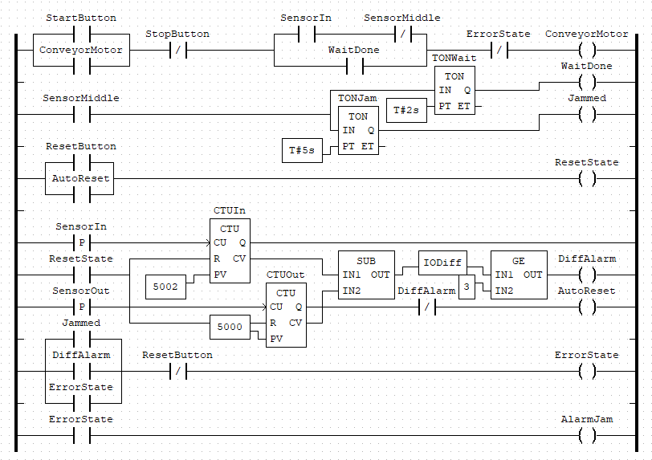

# Automated Assembly Line Control System

An industrial conveyor control system implemented in IEC 61131-3 Ladder Logic using OpenPLC. It models a three-station assembly line with a timed processing halt at the middle station, two layers of fault detection, and continuous operation that resets itself.



---

## System Overview

Three sensors track each part through the line. The middle station halts the conveyor for a timed processing cycle, which could stand for welding, inspection, labeling or any other fixed-duration operation. Two independent fault detection mechanisms watch for jams and abnormal accumulation. Under normal conditions the system runs continuously and resets itself without operator input.

```
[SensorIn] ──── conveyor ──── [SensorMiddle / Process T#2s] ──── [SensorOut]
   count++                          jam detection                   count++
```

---

## Variable Table

| # | Name | Class | Type | Description |
|---|------|-------|------|-------------|
| 1 | SensorIn | Input | BOOL | Detects incoming part |
| 2 | SensorMiddle | Input | BOOL | Processing station presence |
| 3 | SensorOut | Input | BOOL | Exit confirmation |
| 4 | StartButton | Input | BOOL | System start |
| 5 | StopButton | Input | BOOL | System stop |
| 6 | ResetButton | Input | BOOL | Manual fault reset |
| 7 | ConveyorMotor | Output | BOOL | Main drive motor |
| 8 | AlarmJam | Output | BOOL | Fault indicator |
| 9 | TONWait | Local | TON | Processing timer (T#2s) |
| 10 | TONJam | Local | TON | Jam detection timer (T#5s) |
| 11 | CTUIn | Local | CTU | Incoming part counter (PV=5002) |
| 12 | CTUOut | Local | CTU | Outgoing part counter (PV=5000) |
| 13 | WaitDone | Local | BOOL | Processing cycle complete flag |
| 14 | Jammed | Local | BOOL | TONJam output latch |
| 15 | ErrorState | Local | BOOL | System fault latch |
| 16 | IODiff | Local | INT | CTUIn.CV minus CTUOut.CV |
| 17 | DiffAlarm | Local | BOOL | Set when IODiff ≥ 3 |
| 18 | AutoReset | Local | BOOL | Automatic counter reset trigger |
| 19 | ResetState | Local | BOOL | Unified reset signal |

---

## Ladder Logic Rungs

**Rung 1: Motor Control**
```
(StartButton OR ConveyorMotor) AND /StopButton AND (SensorIn OR WaitDone)
AND /SensorMiddle AND /ErrorState → ConveyorMotor
```
A seal-in latch with start and stop logic. After start, the motor holds itself on through its own contact. The normally closed SensorMiddle contact halts the belt when a part arrives at the processing station. Once the processing cycle completes, WaitDone bypasses SensorMiddle so the part can exit.

**Rung 2: Processing Timer (TONWait)**
```
SensorMiddle → TONWait [PT = T#2s] → WaitDone
```
The timer starts when a part reaches the processing station. WaitDone goes TRUE after 2 seconds and releases the motor.

**Rung 3: Jam Timer (TONJam)**
```
SensorMiddle → TONJam [PT = T#5s] → Jammed
```
If SensorMiddle stays active for more than 5 seconds, the part has not cleared the station and a jam is detected.

**Rung 4: Counters and Difference Logic**
```
SensorIn (P)  → CTUIn  [PV=5002, R=ResetState]
SensorOut (P) → CTUOut [PV=5000, R=ResetState]
CTUIn.CV − CTUOut.CV → IODiff    (SUB block)
IODiff ≥ 3            → DiffAlarm (GE block)
CTUOut.Q AND /DiffAlarm → AutoReset
```
Every part entering and leaving is counted, and the difference between the two counts is computed on each scan. If 3 or more parts are on the line at the same time, DiffAlarm fires. When CTUOut reaches its preset, it triggers AutoReset, but only if the line is balanced.

**Rung 5: Fault Latch (ErrorState)**
```
(Jammed OR DiffAlarm OR ErrorState) AND /ResetButton → ErrorState
```
The latch sets on any fault condition and needs the ResetButton to clear, so an operator has to acknowledge the fault before the line restarts.

**Rung 6: Reset Logic**
```
AutoReset OR ResetButton → ResetState
```
ResetState drives the reset pins of both counters. ResetButton also clears ErrorState directly.

**Rung 7: Alarm Output**
```
ErrorState → AlarmJam
```

---

## Fault Detection Logic

### Layer 1: TONJam (time-based)
A part that stays at the processing station for more than 5 seconds triggers a jam. This catches mechanical blockages at the station itself.

### Layer 2: IODiff (count-based)
Every scan computes `IODiff = CTUIn.CV − CTUOut.CV`. If the difference reaches 3, parts are accumulating faster than they leave. This catches jams between stations, which TONJam cannot see.

Both layers drive ErrorState. The motor stops and AlarmJam stays on until an operator resets the line.

---

## Automatic Reset Mechanism

CTUOut has a preset of 5000 and CTUIn a preset of 5002. When CTUOut reaches 5000:
- If `DiffAlarm = 0`, the line is balanced, so AutoReset fires and both counters clear together.
- If `DiffAlarm = 1`, some parts are unaccounted for, so the reset is blocked and the fault path takes over.

The different presets make sure CTUOut always triggers first. Both counters reset in the same scan cycle, so IODiff stays consistent across the reset.

---

## Tools

- [OpenPLC Editor](https://autonomylogic.com/), an IEC 61131-3 Ladder Logic IDE
- IEC 61131-3 function blocks: TON, CTU, SUB, GE
